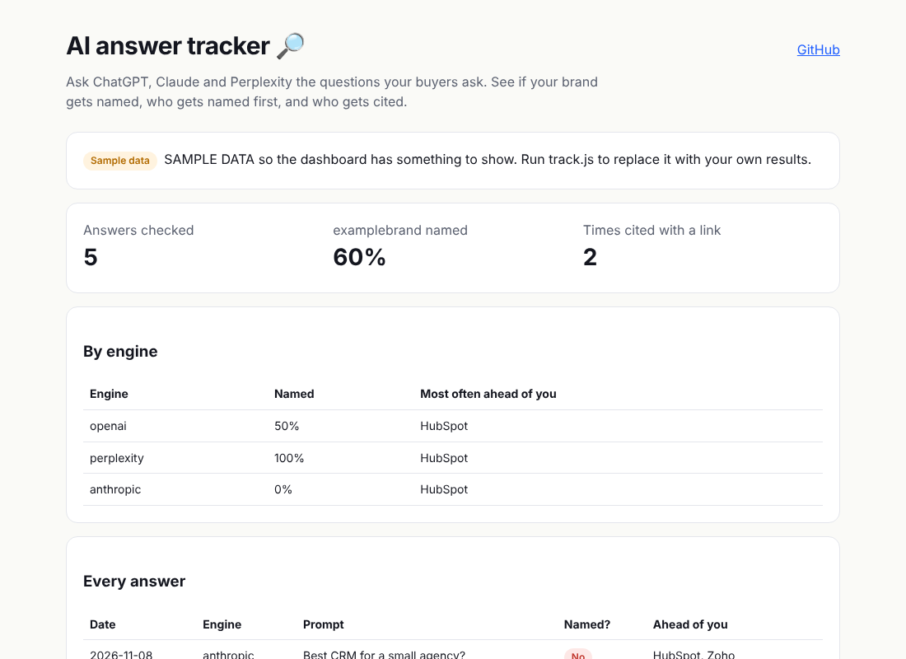

# AI answer tracker 🔎

**Is your brand in the AI answer?** Ask ChatGPT, Claude and Perplexity the same questions your buyers ask, every week, and log whether your brand is named, which competitors are named before you, and whether Perplexity cites your site. Then see the trend on a simple dashboard.

✨ **Dashboard demo (sample data):** https://tiwalade-joanna-okedara.github.io/ai-answer-tracker/



## Why

Search is moving into AI answers, and "do we show up?" is now a weekly question in marketing meetings. Paid tools exist, but you can get a useful signal for a few cents of API calls. I built this to track brands I work on.

## Run it

Needs Node 18+ and at least one API key.

```bash
cp config.example.json config.json      # set your brand, aliases, competitors and prompts
export OPENAI_API_KEY=...               # any of these; engines without a key are skipped
export ANTHROPIC_API_KEY=...
export PERPLEXITY_API_KEY=...
node track.js                            # appends to results.jsonl, rebuilds data.json
npx serve .                              # open the dashboard
```

Run it on a schedule (cron or a GitHub Action) to build a history.

## Honest limits

- API answers can differ from what people see in the consumer apps (no personalisation, different system prompts, sometimes different models).
- Answers vary run to run. Look at the trend over weeks, not a single day.
- The data in `data.json` in this repo is **sample data** so the demo has something to show.

---
Made by [Tiwalade Joanna Okedara-Kalu](https://github.com/tiwalade-joanna-okedara) · MIT licence
